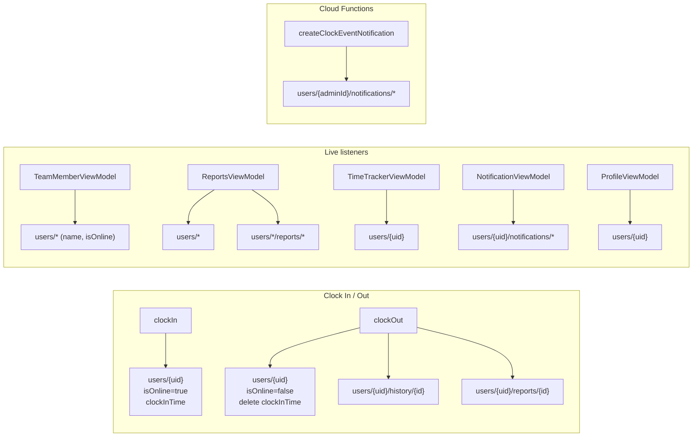
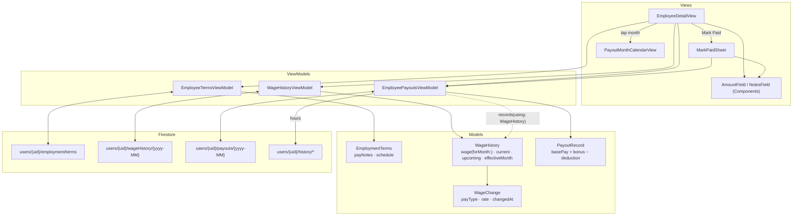

# MainBase

iOS app for team clock-in/out, shift reports, and notifications. Built with SwiftUI and Firebase.

---

## 1. Project overview

MainBase is a SwiftUI iOS app for distributed teams to track work sessions and projects. Team members clock in and out, write an end-of-shift report, and see who is online. From **My Schedule** they see their upcoming shifts, their wage, last month's paycheck, and can request a day off or a shortened day. Admins also get three more tabs: **Projects** (tasks, subtasks, chat, photos, budgets and diagrams), **Operations** (workflow, user-flow and database diagrams) and **Gemini** (ask Gemini questions). Push notifications (via Cloud Functions) cover clock events, task assignments and completions, chat messages, and schedule reminders.

**Primary users**
- **Team members**: clock in/out, write shift reports, view team status and their own history, and open **My Schedule** (shifts, wage, last month's paycheck, day-off / shortened-day requests)
- **Admins** (`users.admin == true`): everything above, plus **Profile → Admin Tools**:
  - employee status
  - wage log (hourly rate or monthly salary; changes start on the 1st of the next month) and pay notes
  - monthly payouts (bonus, deduction, note)
  - weekly schedules
  - employee history
  - Projects, Operations and Gemini tabs
  - archived projects
  - project mains
  - clock-notification preference

---

## 2. Requirements

| Requirement | Version / notes |
|-------------|-----------------|
| macOS | Required for iOS development |
| Xcode | 16+ (project format 77, with SwiftPM and file-system synchronized groups) |
| iOS deployment target | **17.0** |
| Swift | 5.0 |
| Firebase iOS SDK | **12.15.0** (via Swift Package Manager) |
| Firebase products used | Auth, Firestore, Functions, Analytics, Messaging, Storage |
| Firebase project | Shared with `lacoachoffice` — credentials in `GoogleService-Info.plist` |

---

## 3. Setup

### Clone and open

```bash
git clone <repo-url>
cd MainBase
open MainBase.xcodeproj
```

### Firebase config

1. Ensure `MainBase/GoogleService-Info.plist` is present (bundled with the target).
2. If setting up a new environment, download a new plist from the [Firebase Console](https://console.firebase.google.com/) for your iOS app and replace the file.
3. Enable **Email/Password** authentication in Firebase Auth for the project.

### Run

1. Select the **MainBase** scheme.
2. Choose an iOS 17+ simulator or device.
3. Press **Run** (⌘R).

Xcode resolves Firebase dependencies automatically on first build via Swift Package Manager.

### First sign-in

Create an account via **Sign Up** on the auth screen, or use an existing user from the shared Firebase project.

---

## 4. Firebase / backend link

MainBase reads and writes the same Firestore database as **lacoachoffice** (Firebase project `lacoach-59e8d`). MainBase deploys its **own** security rules and Cloud Functions from this repo:

| Resource | Location |
|----------|----------|
| Firestore security rules | `firestore.rules` |
| Firestore indexes | `firestore.indexes.json` |
| Cloud Functions | `functions/index.js` (+ `functions/scheduleTime.js`) |
| Project alias | `.firebaserc` → `lacoach-59e8d` |

**Key Cloud Functions**
- `createClockEventNotification`: callable. Writes "Clock Update" notifications to coworkers and admins, using the shared `fanOutClockEvent` helper.
- `sendUserNotificationPush`: runs when a doc is created in `users/{uid}/notifications/{id}`. Sends FCM/Expo push for every known notification type.
- `setEmployeeStatus`: callable, admin only. Sets `isEmployed` for someone in the same company.
- `enforceClockSchedules`: scheduled every 5 minutes. Sends clock-in/clock-out reminders and does the automatic clock-out (see [Admin tools, pay & scheduling](#admin-tools-pay--scheduling)).
- `onProjectTaskAssigneeChanged`, `onProjectSubtaskAssigneeChanged`, `onProjectTeamMembersChanged`, `onProjectTaskCompleted`, `onProjectSubtaskCompleted`, `onProjectChatMessageCreated`, `onReportChatMessageCreated`: project and chat notifications.

> **Shared project warning:** lacoachoffice also deploys `firestore.rules` and `functions/` to `lacoach-59e8d`, and its versions are different from MainBase's (for example, its rules cover `sales` and `vendors`). Whichever repo deploys last replaces the other's rules and functions. Merge the two before deploying if both apps are in use. Deploy commands are under [Deploying](#deploying).

---

## 5. Running tests

### Unit tests

```bash
xcodebuild test \
  -scheme MainBase \
  -destination 'platform=iOS Simulator,name=iPhone 17' \
  -only-testing:MainBaseTests
```

Or in Xcode: **Product → Test** (⌘U) with the `MainBaseTests` target selected.

### UI tests

```bash
xcodebuild test \
  -scheme MainBase \
  -destination 'platform=iOS Simulator,name=iPhone 17' \
  -only-testing:MainBaseUITests
```

> **Note:** Test targets exist but coverage is minimal. Expand tests when adding ViewModels or Firestore logic.

---

## 6. Architecture conventions

MainBase follows **MVVM** with feature-grouped folders:

| Layer | Folder | Responsibility |
|-------|--------|----------------|
| Model | `Models/` | Plain structs/enums; Firestore mapping in `init(data:)` where needed |
| ViewModel | `ViewModel/` | `@MainActor` `ObservableObject`; Firebase listeners and mutations |
| View | `Views/<Feature>/` | SwiftUI UI only; no direct Firestore calls |
| Shared UI | `Components/` | Reusable form controls, logo, toggles |
| Helpers | `Utilities/` | Theme, view modifiers |

**When adding a feature**
1. Add or extend a model in `Models/`.
2. Create a ViewModel if the screen talks to Firebase or holds non-trivial state.
3. Place the view under `Views/<FeatureName>/`.
4. Wire shared ViewModels from `ContentView` via `@StateObject` + `.environmentObject()` when multiple tabs/sheets need them (e.g. `AuthViewModel`, `TimeTrackerViewModel`).
5. Use local `@StateObject` for ViewModels scoped to one screen (e.g. `ReportsViewModel` in `ReportsListView`).

**Naming**
- Views: `<Feature>View.swift`, `<Feature>SheetView.swift`
- ViewModels: `<Feature>ViewModel.swift`
- One primary type per file

---

## 7. Environment / secrets

| File | Purpose | Committed? |
|------|---------|------------|
| `MainBase/GoogleService-Info.plist` | Firebase iOS app config | Yes (currently in repo) |
| Firebase Auth users | Managed in Firebase Console | — |

**Recommendations**
- Treat `GoogleService-Info.plist` as sensitive in public repos — consider gitignoring it and documenting how to obtain a copy.
- Do not commit service account keys or Admin SDK JSON.
- All Firestore access is client-side with security rules; no API keys beyond the plist are required in the app.

---

## 8. Screens / navigation map

MainBase uses a tab bar after sign-in. No screenshots are checked in yet. Add images to `docs/screenshots/` when available.

```
[Not signed in]
  SignInView
    └── SignUpView (push)

[Signed in — TabView]
  Tab 1: Clock In (TimeTrackerView)
    ├── Clock card (tap to clock in / open ClockOutSheetView)
    ├── TeamMembersSection (live online roster; admins or clocked-in users)
    ├── ReportsListView (shift reports feed → ReportChatView)
    ├── Profile sheet (avatar, top bar) → ProfileSheetView
    │     ├── App Flow Map › (sheet)
    │     ├── History › → HistoryView
    │     └── Admin Tools › (admin only) → AdminToolsView
    │           ├── Clock Notifications
    │           ├── Employees (employed toggle; tap name → EmployeeDetailView)
    │           │     ├── Pay (current / upcoming wage, log wage, wage history, notes)
    │           │     ├── Monthly Payouts
    │           │     │     ├── tap month → PayoutMonthCalendarView (tap day → shifts + reports)
    │           │     │     └── Mark Paid → MarkPaidSheet (bonus, deduction, note)
    │           │     └── Weekly Schedule
    │           ├── Employee History › → EmployeeHistoryView
    │           ├── Archived Projects › (sheet)
    │           └── Manage Project Mains
    ├── Notifications sheet (bell) → NotificationsView
    └── Schedule sheet (calendar icon) → ScheduleView
          ├── Wage card + last month's paycheck card (paid or estimated)
          ├── Request Day Off or Shortened Day → TimeOffRequestSheet
          ├── My requests (status; long-press to withdraw a pending one)
          ├── Next 7 days of shifts (in the device's time zone)
          └── Edit → EditMyScheduleSheet

  Tab 2: Projects (ProjectsListView), admins only
    └── ProjectDetailView (tasks, subtasks, chat, photos, budget, diagrams)

  Tab 3: Operations (OperationsDiagramsView), admins only
    └── Workflow automation · User flow · Database design diagrams

  Tab 4: Gemini (GeminiView), admins only
```

**Tab behavior**
- Default tab on launch: **Clock In**
- Non-admins see only **Clock In**.
- If an admin is already clocked in on first load, the app switches to **Projects** once.

---

## 9. Auth flows

All auth logic lives in `AuthViewModel`. Firebase Auth state is observed on launch; `ContentView` reacts to `isSignedIn` and `currentUserId`.

| Flow | Entry | Behavior |
|------|-------|----------|
| **Sign in** | `SignInView` | Email + password → Firebase Auth; errors shown in alert |
| **Sign up** | `SignUpView` | Validates name, email, company, phone, password, terms → creates Firebase user → sets display name |
| **Forgot password** | Link on sign-in | Sends reset email to the email field value |
| **Sign out** | Profile sheet | `AuthViewModel.signOut()` → returns to sign-in |
| **Session restore** | App launch | Auth listener restores session if Firebase user persists |

**Remember Me**: stored in `UserDefaults` (`remember_me`). If it was off, the restored session is signed out on the next launch.

**Not implemented in MainBase**
- Email change in profile (profile shows read-only email)
- OAuth / Apple Sign In

---

## 10. Push notifications

The app registers for remote notifications on launch (`AppDelegate`) and saves the FCM token to `users/{uid}.fcmToken` (`PushNotificationService`). Push banners show even while the app is in the foreground.

1. An event happens: a clock in/out, a task assignment or completion, a chat message, or a schedule reminder from `enforceClockSchedules`.
2. A Cloud Function writes a doc to `users/{recipientId}/notifications/{id}`.
3. `sendUserNotificationPush` reads the recipient's FCM/Expo tokens and sends the push.

**Who gets clock updates**
- Non-admins only while they are clocked in themselves.
- Admins by their **Clock Notifications** preference in Admin Tools: all or none.

**In-app notifications**
- `NotificationViewModel` listens to `users/{currentUserId}/notifications`
- Shown in the bell sheet on the Clock In tab (`WorkNotificationCard` icon per `NotificationType`)
- Supports **Mark all read**

---

## 11. Known limitations

- **Clock-out report required**: the user must enter text before clocking out. The automatic clock-outs (8-hour cap, scheduled end) fill in a report for them.
- **Reports feed**: shows all users' reports. No filtering by date or person.
- **Offline**: no explicit offline queue. Firestore calls may fail silently in some ViewModels.
- **Schedule time zones**: each schedule has its own time zone (`timeZone` on `users/{uid}/employment/terms`), picked in the schedule editor; schedules saved without one are US Pacific. Pay days and months are always Pacific.
- **Payouts**: only admins can mark a month paid. The employee doing it is a TODO (`PayoutRecord`).
- **Time-off requests**: employees can send them, but there is no admin screen to approve or deny them yet, and admins aren't notified. For now an admin sets `status` to `approved` / `denied` on `users/{uid}/timeOffRequests/{id}` directly. An approved request doesn't change the weekly schedule or the clock reminders from `enforceClockSchedules`.
- **Overnight shifts**: a scheduled shift can't cross midnight (end must be after start).
- **Wage corrections**: a wage already in effect can't be edited. A typo in the first wage can only be fixed by logging a new wage, which starts next month.
- **Shared Firebase project**: see the warning in section 4.

---

## 12. Recent changes

| Change | Summary |
|--------|---------|
| My Schedule | `ScheduleView` shows the employee's wage, last month's paycheck (frozen if paid, otherwise estimated) and upcoming shifts, and lets them request a day off or a shortened day (`TimeOffRequestSheet` → `users/{uid}/timeOffRequests`) |
| Admin Tools | Admin-only screen from Profile: clock notifications, employees, employee history, archived projects, project mains |
| Wage log | Wages are logged in `users/{uid}/wageHistory` with the date logged. Each wage has its own currency (USD, EUR, GBP, JPY, CNY, …; older entries are USD). The first wage applies right away; later changes start on the 1st of the next month |
| Pay & schedule | `EmployeeDetailView`: wage, pay notes, weekly schedule and its time zone |
| Monthly payouts | Per-month estimates at that month's wage. **Mark Paid** adds bonus / deduction / note and locks the numbers in `users/{uid}/payouts`. Tap a month for a calendar of hours (and hourly earnings) per day |
| Schedule enforcement | `enforceClockSchedules`: clock-in reminder at +15m, clock-out reminder at +30m, auto clock-out at +90m (recorded at the scheduled end). Clock-in within 30m of start is recorded as the start |
| History | Moved behind **History ›** (own) and **Employee History ›** (admins) |
| Tabs | **Clock In** for everyone; **Projects**, **Operations**, **Gemini** for admins only, via `AppTab` (reports feed lives on Clock In) |
| Projects | Tasks, subtasks, chat, photos, budget, diagrams, archive/restore |
| Clock out | Writes both `history` and `reports` subcollections |
| Reports | A report can be tagged with one project Main (clock-out sheet or Edit Report). Owners can edit the text, Main and links of any past report; edits keep the original time and store no edit time (no "edited" label) |

<!-- Replace with dated changelog entries as the project grows -->

---

## 13. Contributing

### Branch workflow

1. Branch from `main` (or the active feature branch, e.g. `ft/reports`)
2. Use descriptive branch names: `ft/<feature>`, `fix/<issue>`, `docs/<topic>`
3. Open a PR with a short summary and test plan

### Code style

- Match existing SwiftUI + MVVM patterns in this repo
- Keep views thin; move Firebase logic to ViewModels
- Prefer shared components in `Components/` over duplicating form UI
- Run a local build before pushing: `xcodebuild -scheme MainBase -destination 'platform=iOS Simulator,name=iPhone 17' build`

### Schema changes

If you add or rename Firestore fields:
1. Update the **Firestore data structure** section below
2. Update `firestore.rules` if access patterns change (and keep lacoachoffice's rules in mind; see section 4)
3. Coordinate with Cloud Functions in `functions/` if notifications or push payloads change. `NOTIFICATION_TYPES` in `functions/index.js` mirrors `NotificationType.swift`.

---

## MVVM file structure

```
MainBase/
├── MainBaseApp.swift                    ← App entry (Firebase init)
├── AppDelegate.swift                    ← Push registration, FCM token
│
├── Models/
│   ├── AppTab.swift                     ← Tab enum (clockIn, projects, operations)
│   ├── EmployeeEntry.swift              ← Admin employee list row
│   ├── EmploymentTerms.swift            ← Pay notes, weekly schedule and its time zone, shift math
│   ├── HistoryEntry.swift               ← Clock-out history row
│   ├── NotificationType.swift           ← Notification + clock action enums (mirrors functions)
│   ├── PayoutRecord.swift               ← Monthly payout: base pay + bonus − deduction, note
│   ├── TimeOffRequest.swift             ← Day-off / shortened-day request (pending / approved / denied)
│   ├── WageChange.swift                 ← PayType, PayCurrency, WageChange (log entry), WageHistory (effective-date rules)
│   ├── Project*.swift, OperationItem…   ← Projects, tasks, chat, expenses, mains
│   ├── Report.swift, ReportChatMessage.swift
│   ├── TeamMember.swift, AssignableUser.swift
│   ├── UserProfile.swift                ← Profile fields + clock notification preference
│   └── WorkNotification.swift           ← In-app notification
│
├── ViewModel/
│   ├── AuthViewModel.swift              ← Sign in/up, auth state, Remember Me
│   ├── AdminEmployeesViewModel.swift    ← Company employees, employed toggle
│   ├── EmployeePayoutsViewModel.swift   ← Monthly payouts for one employee
│   ├── EmployeeTermsViewModel.swift     ← Pay notes & schedule for one employee
│   ├── HistoryViewModel.swift           ← Clock-out history (self or employee)
│   ├── NotificationViewModel.swift      ← User notifications
│   ├── OperationsViewModel.swift
│   ├── ProfileViewModel.swift           ← Load/save profile
│   ├── ProjectMainsAdminViewModel.swift ← Project mains (admin)
│   ├── ProjectsViewModel.swift          ← Projects, tasks, archive/restore
│   ├── ReportsViewModel.swift           ← All users' reports feed
│   ├── TeamMemberViewModel.swift        ← Team online status
│   ├── TimeOffRequestsViewModel.swift   ← The signed-in employee's time-off requests: load, submit, withdraw
│   ├── TimeTrackerViewModel.swift       ← Clock in/out, scheduled clock-in snap, 8h cap
│   └── WageHistoryViewModel.swift       ← Wage log for one employee
│
├── Services/
│   ├── ExchangeRates.swift              ← Daily USD rates (Frankfurter/ECB) for admin "≈ $" figures
│   └── PushNotificationService.swift    ← Saves FCM token
│
├── Views/
│   ├── ContentView.swift                ← Root: auth gate + TabView
│   ├── Auth/                            ← SignInView, SignUpView
│   ├── TimeTracker/                     ← Clock In tab, ClockOutSheetView, TeamMembersSection
│   ├── Reports/                         ← ReportsListView, ReportChatView
│   ├── Projects/                        ← Projects tab and project detail sheets
│   ├── Operations/                      ← Operations tab diagrams
│   ├── Notifications/                   ← NotificationsView, WorkNotificationCard
│   ├── Schedule/                        ← ScheduleView, EditMyScheduleSheet, TimeOffRequestSheet
│   ├── FlowMap/                         ← AppFlowMapView
│   └── Profile/
│       ├── ProfileSheetView.swift       ← Profile + ProfileNavRow
│       ├── HistoryView.swift            ← HistoryView, EmployeeHistoryView, HistoryEntriesList
│       ├── AdminToolsView.swift         ← Admin-only hub
│       ├── EmployeeDetailView.swift     ← Wage, payouts, notes, schedule for one employee
│       ├── MarkPaidSheet.swift          ← Bonus / deduction / note, then mark a month paid
│       ├── PayoutMonthCalendarView.swift ← Hours (and hourly earnings) per day; tap a day for shifts + reports
│       └── ManageProjectMainsView.swift
│
├── Components/                          ← Form fields (incl. AmountField, NotesField), logo, pickers, link previews
└── Utilities/                           ← Theme, MonthGrouping, CountryHelper, formatting helpers
```

### How layers connect

```mermaid
flowchart TB
    subgraph App
        MainBaseApp --> ContentView
    end

    subgraph Views
        ContentView --> SignInView
        ContentView --> TabView
        TabView --> TimeTrackerView
        TabView --> ProjectsListView
        TabView --> OperationsDiagramsView
        TimeTrackerView --> ReportsListView
        TimeTrackerView --> TeamMembersSection
        TimeTrackerView --> ClockOutSheetView
        TimeTrackerView --> NotificationsView
        TimeTrackerView --> ProfileSheetView
    end

    subgraph ViewModels
        AuthVM[AuthViewModel]
        NotifVM[NotificationViewModel]
        TrackerVM[TimeTrackerViewModel]
        TeamVM[TeamMemberViewModel]
        ReportsVM[ReportsViewModel]
        ProfileVM[ProfileViewModel]
        ProjectsVM[ProjectsViewModel]
        AdminVM[AdminEmployeesViewModel]
        TermsVM[EmployeeTermsViewModel]
        WageVM[WageHistoryViewModel]
        PayoutsVM[EmployeePayoutsViewModel]
        HistoryVM[HistoryViewModel]
        TimeOffVM[TimeOffRequestsViewModel]
    end

    subgraph Models
        UserProfile
        TeamMember
        Report
        WorkNotification
        AppTab
        EmploymentTerms
        WageHistory
        PayoutRecord
        EmployeeEntry
        TimeOffRequest
    end

    ContentView --> AuthVM
    ContentView --> NotifVM
    ContentView --> TrackerVM
    SignInView --> AuthVM
    SignUpView --> AuthVM
    TimeTrackerView --> NotifVM
    TimeTrackerView --> AuthVM
    TimeTrackerView --> TrackerVM
    TimeTrackerView --> TeamVM
    ReportsListView --> ReportsVM
    ProfileSheetView --> ProfileVM
    ProfileSheetView --> AuthVM
    NotificationsView --> NotifVM
    ProjectsListView --> ProjectsVM
    ProfileSheetView --> AdminToolsView
    ProfileSheetView --> HistoryView
    HistoryView --> HistoryVM
    AdminToolsView --> AdminVM
    AdminToolsView --> EmployeeDetailView
    EmployeeDetailView --> TermsVM
    EmployeeDetailView --> WageVM
    EmployeeDetailView --> PayoutsVM
    EmployeeDetailView --> MarkPaidSheet
    MarkPaidSheet --> PayoutsVM
    TermsVM --> EmploymentTerms
    WageVM --> WageHistory
    PayoutsVM --> PayoutRecord
    PayoutsVM --> WageHistory
    AdminVM --> EmployeeEntry
    TimeTrackerView --> ScheduleView
    ScheduleView --> TermsVM
    ScheduleView --> WageVM
    ScheduleView --> PayoutsVM
    ScheduleView --> TimeOffVM
    ScheduleView --> TimeOffRequestSheet
    TimeOffRequestSheet --> TimeOffVM
    TimeOffVM --> TimeOffRequest

    TeamVM --> TeamMember
    ReportsVM --> Report
    ProfileVM --> UserProfile
    NotifVM --> WorkNotification
    TrackerVM --> Report
```



| Screen | ViewModel(s) | Model(s) |
|--------|--------------|----------|
| `ContentView` | `AuthViewModel`, `NotificationViewModel`, `TimeTrackerViewModel` | `AppTab` |
| Clock In tab | `TimeTrackerViewModel`, `TeamMemberViewModel`, `NotificationViewModel` | `TeamMember` |
| Reports feed (Clock In tab) | `ReportsViewModel` | `Report` |
| Projects tab | `ProjectsViewModel` | `Project` and related |
| Profile sheet | `ProfileViewModel`, `AuthViewModel` | `UserProfile` |
| History / Employee History | `HistoryViewModel` (+ `AdminEmployeesViewModel`) | `HistoryEntry` |
| Admin Tools | `AdminEmployeesViewModel`, `ProfileViewModel`, `ProjectsViewModel` | `EmployeeEntry` |
| Employee detail | `EmployeeTermsViewModel`, `WageHistoryViewModel`, `EmployeePayoutsViewModel` | `EmploymentTerms`, `WageHistory`/`WageChange`, `PayoutRecord` |
| Mark Paid sheet | `EmployeePayoutsViewModel` | `PayoutRecord` |
| My Schedule (`ScheduleView`) | `EmployeeTermsViewModel`, `WageHistoryViewModel`, `EmployeePayoutsViewModel`, `TimeOffRequestsViewModel` (all for the signed-in user) | `EmploymentTerms`, `WageHistory`, `PayoutRecord`, `TimeOffRequest` |
| Time-off request sheet | `TimeOffRequestsViewModel` | `TimeOffRequest` |
| Notifications sheet | `NotificationViewModel` | `WorkNotification` |

## Firestore data structure

MainBase shares a Firebase backend with the lacoachoffice project. Below is what the iOS app and its Cloud Functions read/write under `users/`. Projects, `projectMains` and `operationsItems` are top-level collections covered by `firestore.rules`.

```
firestore/
└── users/  {userId}
    │
    ├── [user document fields]
    │   ├── name: string              ← Profile, team list, reports feed
    │   ├── email: string             ← Profile
    │   ├── company: string           ← Profile
    │   ├── phone: string             ← Profile
    │   ├── country: string           ← Profile
    │   ├── isOnline: bool            ← Clock in/out, team status
    │   ├── clockInTime: timestamp    ← Clock in/out, elapsed timer
    │   ├── lastClockOut: timestamp   ← Clock out; schedule reminders
    │   ├── isEmployed: bool          ← Admin Tools (via setEmployeeStatus)
    │   ├── clockNotificationPreference: "all" | "none"  ← Admins only
    │   │
    │   ├── admin: bool               ← Admin Tools gate, notification rules
    │   ├── currentTask: string       ← Backend / other clients
    │   ├── createdAt: timestamp      ← Set on first user doc create
    │   ├── fcmToken / fcmTokens      ← Push (Cloud Functions)
    │   └── expoPushToken(s)          ← Push (Cloud Functions)
    │
    ├── history/  {historyId}         ← Written on clock out
    │   ├── clockIn: timestamp
    │   ├── clockOut: timestamp
    │   ├── durationMs: number
    │   ├── durationFormatted: string   e.g. "2h 15m"
    │   ├── report: string
    │   └── createdAt: timestamp
    │
    ├── employment/
    │   ├── terms                     ← Admin-set pay notes & schedule (see Admin tools section)
    │   └── scheduleState             ← enforceClockSchedules reminder bookkeeping
    │
    ├── wageHistory/  {yyyy-MM}       ← Wage log: payType, rate, currency, changedAt (month = start date)
    │
    ├── payouts/  {yyyy-MM}           ← Months marked paid (frozen hours/rate/currency/base, USD rate, bonus, deduction, note)
    │
    ├── timeOffRequests/  {requestId} ← Employee's day-off / shortened-day requests
    │   ├── kind: "dayOff" | "shortenedDay"
    │   ├── shiftStart / shiftEnd: timestamp          ← The scheduled shift
    │   ├── requestedStart / requestedEnd: timestamp  ← Hours to work instead (shortenedDay only)
    │   ├── reason: string
    │   ├── status: "pending" | "approved" | "denied"
    │   ├── requestedByEmail: string
    │   └── createdAt: timestamp
    │
    ├── reports/  {reportId}          ← Written on clock out (if report non-empty)
    │   ├── reportText: string        ← The owner can edit it later (EditReportSheet); no edit time is stored
    │   ├── projectMainId: string     ← Optional; at most one project Main per report
    │   ├── links: array              ← Links added on the clock-out sheet; the owner can edit them later (EditReportSheet)
    │   └── timestamp: timestamp      ← Clock-out time; never changed by an edit
    │
    ├── notifications/  {notificationId}  ← Created by Cloud Functions
    │   ├── type: string                e.g. "clock_event", "schedule_reminder"
    │   ├── title: string
    │   ├── body: string
    │   ├── read: bool
    │   ├── action: string              "clock_in" | "clock_out"
    │   ├── actorUserId: string
    │   ├── actorName: string
    │   ├── recipientUserId: string
    │   └── createdAt: timestamp
    │
    ├── fcmTokens/  {tokenId}         ← Push infra (not used directly in iOS app)
    └── expoPushTokens/  {tokenId}    ← Push infra (not used directly in iOS app)
```

### Data flow by feature



### Collection summary

| Path | Written by MainBase | Read by |
|------|---------------------|---------|
| `users/{uid}` | Clock in/out, profile save | `TimeTrackerViewModel`, `ProfileViewModel`, `TeamMemberViewModel`, `ReportsViewModel` |
| `users/{uid}/history/{id}` | Clock out, auto clock-out (function) | `HistoryViewModel` → History / Employee History, `EmployeePayoutsViewModel` |
| `users/{uid}/employment/terms` | Admin (Employee detail); the employee may edit only `schedule` (EditMyScheduleSheet) | `EmployeeTermsViewModel`, `TimeTrackerViewModel`, `enforceClockSchedules` |
| `users/{uid}/wageHistory/{yyyy-MM}` | Admin (Log Wage) | `WageHistoryViewModel` → payouts, My Schedule wage card |
| `users/{uid}/employment/scheduleState` | `enforceClockSchedules` | `enforceClockSchedules` |
| `users/{uid}/payouts/{yyyy-MM}` | Admin (MarkPaidSheet) | `EmployeePayoutsViewModel` → payouts, My Schedule paycheck card |
| `users/{uid}/timeOffRequests/{id}` | The employee (TimeOffRequestSheet; withdraw while pending); an admin answers | `TimeOffRequestsViewModel` → My Schedule |
| `users/{uid}/reports/{id}` | Clock out; the owner may edit `reportText` / `projectMainId` / `links` (EditReportSheet) | `ReportsViewModel` → Reports tab |
| `users/{uid}/notifications/{id}` | Cloud Functions | `NotificationViewModel` → bell sheet |

## Admin tools, pay & scheduling

Admins open **Profile → Admin Tools** to manage employees. Tapping an employee opens **EmployeeDetailView**, where the admin:
- logs the employee's wage (hourly rate or monthly salary)
- reviews and marks monthly payouts (with bonus, deduction and note)
- sets pay notes and the weekly schedule

The `enforceClockSchedules` Cloud Function then sends clock-in/clock-out reminders and automatically clocks people out based on that schedule.

**Each schedule's times are in its own time zone** (`timeZone` on the terms doc, an IANA id like `Asia/Tokyo`; Pacific if unset). The admin or the employee picks it in the schedule editor, and `enforceClockSchedules` enforces the shifts in that zone, so a 9:00 AM Tokyo shift stays 9:00 AM Tokyo through US daylight saving changes. **Pay days and months are always US Pacific (`America/Los_Angeles`).**

### What employees see (My Schedule)

The calendar icon on the Clock In tab opens `ScheduleView` for the signed-in employee:
- **Wage**: the wage in effect this month (`WageHistory.current()`), as a monthly salary or an hourly rate.
- **Last month's paycheck**: last Pacific month's `PayoutRecord`. It's the frozen **Paid** amount once an admin marks it paid, and until then it's an **Estimated** amount (hours × rate, or the salary).
- **Request Day Off or Shortened Day** opens `TimeOffRequestSheet`. The employee picks one of their scheduled shifts in the next 60 days and either a full day off or the hours they'll work instead, plus an optional reason. It's saved as `pending` in `users/{uid}/timeOffRequests`. A shift with a pending or approved request is marked in the shift list and can't be requested again. A pending request can be withdrawn with a long-press.
- **Edit** opens `EditMyScheduleSheet`, which changes only the weekly schedule, not the pay notes.

### Wage rules

Every wage is its own entry in `users/{uid}/wageHistory/{yyyy-MM}`. Nothing is edited in place, so the log keeps every wage the employee has had, with the date each was logged.

| Change | Takes effect |
|--------|--------------|
| **First wage** | Immediately: the month it's logged, **and all earlier months** |
| Salary → hourly | 1st of the next month |
| Salary → new salary | 1st of the next month |
| Hourly → salary | 1st of the next month |
| Hourly → new hourly | 1st of the next month |

- Logging again before a change starts **replaces** that upcoming change (one entry per month). It can also be cancelled.
- A payout month uses the wage in effect that month. **Work logged before the first wage uses the first wage.**
- Example: the employee starts Feb 1 with no wage. You log $3/hour on Apr 15, then $4/hour on Jun 30. Feb 1 – Jun 30 pays $3/hour, and July onward pays $4/hour.
- Pay saved on `employment/terms` before the wage log existed (`payType`/`payRate`) is moved into the log as the first wage the next time an admin opens that employee.

### Payouts

- The payouts list covers **every month from the employee's first logged shift** through the current month.
- **Unpaid month:** an estimate. Hourly is hours × that month's hourly rate. Salary is that month's monthly salary.
- **Mark Paid** opens `MarkPaidSheet`, which adds an optional **bonus**, **deduction** and **note**. **Total = base pay + bonus − deduction**, and it can't go below $0. It freezes everything in `users/{uid}/payouts/{yyyy-MM}`, so later wage changes don't rewrite paid months.
- **Tap a month** for `PayoutMonthCalendarView`: hours per day, earnings per day for hourly, and the base / bonus / deduction / total / note summary.
- **Tap a day** in that calendar to see each shift's clock-in and clock-out times (PT), its duration, and the report written at clock-out.

**Not implemented yet (TODOs in code):**
- Employees should see schedule times in their profile country's timezone: `EmploymentTerms.scheduleTimeZone`.
- Employees should be able to mark their own payouts as paid: `PayoutRecord`, `EmployeePayoutsViewModel.markPaid`, and the `payouts` rule in `firestore.rules`.

### How the pieces connect



### MVVM map

```json
{
  "views": {
    "ProfileSheetView": {
      "file": "Views/Profile/ProfileSheetView.swift",
      "viewModels": ["ProfileViewModel"],
      "navigatesTo": {
        "History ›": "HistoryView",
        "Admin Tools › (admin only)": "AdminToolsView"
      },
      "sharedSubviews": ["ProfileNavRow"]
    },
    "HistoryView": {
      "file": "Views/Profile/HistoryView.swift",
      "viewModels": ["HistoryViewModel (current user)"],
      "sharedSubviews": ["HistoryEntriesList", "HistoryRow (private)"]
    },
    "AdminToolsView": {
      "file": "Views/Profile/AdminToolsView.swift",
      "viewModels": ["ProfileViewModel (passed in)", "AdminEmployeesViewModel", "ProjectsViewModel"],
      "sections": ["Clock Notifications", "Employees", "Employee History ›", "Archived Projects ›", "ManageProjectMainsView"],
      "navigatesTo": {
        "tap employee name": "EmployeeDetailView",
        "Employee History ›": "EmployeeHistoryView",
        "Archived Projects ›": "ArchivedProjectsView (sheet)"
      }
    },
    "EmployeeHistoryView": {
      "file": "Views/Profile/HistoryView.swift",
      "viewModels": ["AdminEmployeesViewModel (passed in, feeds the picker)", "HistoryViewModel (selected employee)"]
    },
    "EmployeeDetailView": {
      "file": "Views/Profile/EmployeeDetailView.swift",
      "viewModels": ["EmployeeTermsViewModel", "WageHistoryViewModel", "EmployeePayoutsViewModel"],
      "sections": [
        "Pay: current wage, upcoming change (cancel), log new wage, wage history, notes",
        "Monthly Payouts",
        "Weekly Schedule",
        "Save Notes & Schedule"
      ],
      "localState": {
        "newWageType": "PayType for the new-wage editor",
        "newWageText": "String bound to the new wage's AmountField",
        "showLogWageConfirm": "Bool for the Log Wage confirmation",
        "payoutToMarkPaid": "PayoutRecord? presenting MarkPaidSheet"
      },
      "navigatesTo": {
        "tap a payout month": "PayoutMonthCalendarView",
        "Mark Paid": "MarkPaidSheet (sheet)"
      }
    },
    "MarkPaidSheet": {
      "file": "Views/Profile/MarkPaidSheet.swift",
      "viewModels": ["EmployeePayoutsViewModel (passed in)"],
      "inputs": ["record: PayoutRecord"],
      "fields": ["Bonus (AmountField)", "Deduction (AmountField)", "Note (NotesField)"],
      "shows": ["base pay", "live total = base + bonus − deduction (can't be negative)"]
    },
    "PayoutMonthCalendarView": {
      "file": "Views/Profile/PayoutMonthCalendarView.swift",
      "inputs": ["record: PayoutRecord", "entriesByDay: [String: [HistoryEntry]] (from EmployeePayoutsViewModel)"],
      "localState": { "selectedDayKey": "String? — tapped \"yyyy-MM-dd\"" },
      "shows": [
        "summary: hours, rate/earned or salary, bonus, deduction, total, note",
        "Sunday-first Pacific calendar: hours per day, plus earnings per day when hourly",
        "tap a day: each shift's clock in – out (PT), duration, and the report written; day total and hourly earnings"
      ]
    }
  },

  "components": {
    "AmountField": "Components/AmountField.swift — titled \"$ [0.00] unit\" box; digits + 2 decimals only; String-bound",
    "NotesField": "Components/AmountField.swift — titled multi-line text box"
  },

  "viewModels": {
    "ProfileViewModel": {
      "published": ["profile: UserProfile", "isLoading", "isSaving", "alertMessage", "showAlert"],
      "methods": ["loadProfile()", "saveProfile()", "saveClockNotificationPreference()"]
    },
    "AdminEmployeesViewModel": {
      "published": ["employees: [EmployeeEntry]", "isLoading", "errorMessage"],
      "methods": ["startListening(company:)", "stopListening()", "setEmployed(_:for:) → setEmployeeStatus Cloud Function"]
    },
    "HistoryViewModel": {
      "published": ["sections: [MonthSection<HistoryEntry>]", "isLoading"],
      "methods": ["startListening(userId:)", "stopListening()"]
    },
    "EmployeeTermsViewModel": {
      "init": "userId",
      "published": ["terms: EmploymentTerms (pay notes + schedule form)", "isLoading", "isSaving", "alertMessage"],
      "methods": ["load()", "save() — checks each working day's end > start", "saveSchedule(_:) → String? error — employee's own edit; writes only schedule"]
    },
    "WageHistoryViewModel": {
      "init": "userId",
      "published": ["history: WageHistory", "isLoading", "isSaving", "alertMessage"],
      "methods": [
        "load() — wageHistory docs; moves legacy terms payType/payRate in as the first wage",
        "logNewWage(payType:rate:) → Bool — effective month per WageHistory; rejects an unchanged wage",
        "cancelUpcoming(_:) — only changes that haven't started"
      ]
    },
    "EmployeePayoutsViewModel": {
      "init": "userId",
      "published": [
        "monthKeys: [String] (newest first)",
        "hoursByMonth: [String: Double]",
        "entriesByDay: [String: [HistoryEntry]] (\"yyyy-MM-dd\", earliest first)",
        "paidRecords: [String: PayoutRecord]",
        "isLoading",
        "alertMessage"
      ],
      "methods": [
        "load() — all history + all payout docs; monthKeys = first shift month → current month",
        "records(using: WageHistory) → [PayoutRecord] (paid = frozen, unpaid = estimate at that month's wage)",
        "markPaid(_:bonus:deduction:note:) → String? error — admin only (TODO: employee too)",
        "unmarkPaid(_:)"
      ]
    },
    "TimeOffRequestsViewModel": {
      "init": "userId",
      "published": ["requests: [TimeOffRequest] (soonest shift first)", "isSaving", "alertMessage"],
      "methods": [
        "load()",
        "upcoming — requests whose shift hasn't ended",
        "activeRequest(for:) — pending or approved request for a shift",
        "submit(kind:shift:requested:reason:) → String? error — one active request per shift; a shortened day must fit inside the shift",
        "withdraw(_:) — pending only"
      ]
    },
    "TimeTrackerViewModel": {
      "scheduleChanges": [
        "loadTerms() — reads the user's own employment/terms",
        "scheduledClockInTime(for:) — clock-in within 30 min of start is recorded as the start",
        "8-hour auto clock-out skipped for sessions inside a scheduled shift"
      ]
    }
  },

  "models": {
    "EmploymentTerms": {
      "file": "Models/EmploymentTerms.swift",
      "fields": {
        "payNotes": "String — free-form admin notes",
        "schedule": "[Weekday: WorkDay]"
      },
      "static": {
        "scheduleTimeZone": "America/Los_Angeles (TODO: show employees their country's time)",
        "clockInSnapWindow": "30 min",
        "earlyClockInAllowance": "4 h"
      },
      "methods": ["shift(on:) → DateInterval?", "upcomingShifts(days:now:) → [DateInterval]", "shift(containingClockIn:) → DateInterval?"]
    },
    "WorkDay": { "isWorking": "Bool", "startMinutes": "Int (minutes since midnight)", "endMinutes": "Int" },
    "Weekday": { "cases": ["monday", "…", "sunday"] },
    "PayType": {
      "file": "Models/WageChange.swift",
      "cases": ["hourly", "salary"],
      "rateLabel": ["Hourly rate", "Monthly salary"],
      "rateUnit": ["/ hour", "/ month"]
    },
    "WageChange": {
      "file": "Models/WageChange.swift",
      "fields": {
        "id": "\"yyyy-MM\" Pacific month the wage starts on the 1st of (Firestore doc id)",
        "payType": "PayType",
        "rate": "Double — $/hour or $/month",
        "changedAt": "Date — when it was logged",
        "changedByEmail": "String"
      },
      "computed": ["summary (\"Hourly · $25.00 / hour\")", "effectiveDateText (\"Oct 1, 2026\")"]
    },
    "WageHistory": {
      "file": "Models/WageChange.swift",
      "fields": { "changes": "[WageChange] oldest first" },
      "methods": [
        "wage(forMonth:) — latest change on/before the month, else the first wage",
        "current(now:)",
        "upcoming(now:)",
        "effectiveMonth(forChangeAt:) — this month if first wage, else next month"
      ]
    },
    "PayoutRecord": {
      "file": "Models/PayoutRecord.swift",
      "fields": {
        "id": "\"yyyy-MM\" Pacific month (Firestore doc id)",
        "payType": "PayType",
        "rate": "Double? — wage in effect that month",
        "hoursWorked": "Double",
        "bonus": "Double (default 0)",
        "deduction": "Double (default 0)",
        "note": "String",
        "paidAt": "Date?"
      },
      "computed": [
        "isPaid",
        "basePay (hourly: rate × hours, rounded to cents; salary: rate)",
        "amount (basePay + bonus − deduction)",
        "monthTitle"
      ],
      "static": ["calendar (Pacific)", "monthKey(for:)", "monthStart(forKey:)", "dayKey(for:)"]
    },
    "TimeOffRequest": {
      "file": "Models/TimeOffRequest.swift",
      "fields": {
        "kind": "dayOff | shortenedDay",
        "shiftStart / shiftEnd": "Date — the scheduled shift",
        "requestedStart / requestedEnd": "Date? — shortenedDay only",
        "reason": "String",
        "status": "pending | approved | denied",
        "createdAt": "Date"
      }
    },
    "HistoryEntry": { "id": "String", "clockIn": "Date", "clockOut": "Date", "durationFormatted": "String", "report": "String", "computed": ["hours"] },
    "EmployeeEntry": { "id": "String", "name": "String", "isEmployed": "Bool" },
    "UserProfile": { "adds": "clockNotificationPreference: ClockNotificationPreference" },
    "NotificationType": { "added": "scheduleReminder = \"schedule_reminder\"" }
  },

  "firestore": {
    "users/{uid}": {
      "readBy": "any signed-in user",
      "scheduleFields": ["isOnline", "clockInTime", "lastClockOut", "country (profile only; not used for time yet)"]
    },
    "users/{uid}/employment/terms": {
      "readBy": "the employee or a same-company admin",
      "writeBy": "a same-company admin",
      "example": {
        "payNotes": "Overtime at 1.5× after 40 hrs.",
        "schedule": {
          "monday": { "isWorking": true, "startMinutes": 540, "endMinutes": 1020 },
          "saturday": { "isWorking": false, "startMinutes": 540, "endMinutes": 1020 }
        },
        "updatedAt": "<serverTimestamp>",
        "updatedByEmail": "admin@company.com"
      }
    },
    "users/{uid}/wageHistory/{yyyy-MM}": {
      "readBy": "the employee or a same-company admin",
      "writeBy": "a same-company admin",
      "examples": {
        "2026-09": {
          "payType": "hourly",
          "rate": 25,
          "effectiveMonth": "2026-09",
          "changedAt": "2026-09-12T17:03:00Z",
          "changedByEmail": "admin@company.com"
        },
        "2026-10": {
          "payType": "salary",
          "rate": 5000,
          "effectiveMonth": "2026-10",
          "changedAt": "2026-09-27T20:15:00Z",
          "changedByEmail": "admin@company.com"
        }
      }
    },
    "users/{uid}/employment/scheduleState": {
      "writeBy": "enforceClockSchedules Cloud Function only",
      "example": { "clockInReminderShift": "2026-09-25", "clockOutReminderShift": "2026-09-25", "updatedAt": "<Date>" }
    },
    "users/{uid}/payouts/{yyyy-MM}": {
      "readBy": "the employee or a same-company admin",
      "writeBy": "a same-company admin (TODO: employee can also mark as paid)",
      "example": {
        "payType": "hourly",
        "rate": 25,
        "hoursWorked": 152.5,
        "basePay": 3812.5,
        "bonus": 200,
        "deduction": 50,
        "note": "Holiday bonus; uniform deduction.",
        "amount": 3962.5,
        "paidAt": "<serverTimestamp>",
        "paidByEmail": "admin@company.com"
      }
    },
    "users/{uid}/timeOffRequests/{id}": {
      "readBy": "the employee or a same-company admin",
      "createBy": "the employee, status must be \"pending\"",
      "updateBy": "a same-company admin (approve / deny)",
      "deleteBy": "the employee while pending, or a same-company admin",
      "example": {
        "kind": "shortenedDay",
        "shiftStart": "2026-10-05T16:00:00Z",
        "shiftEnd": "2026-10-06T00:00:00Z",
        "requestedStart": "2026-10-05T16:00:00Z",
        "requestedEnd": "2026-10-05T20:00:00Z",
        "reason": "Dentist appointment",
        "status": "pending",
        "requestedByEmail": "employee@company.com",
        "createdAt": "<serverTimestamp>"
      }
    },
    "users/{uid}/history/{id}": {
      "addedByAutoClockOut": { "report": "Automatically clocked out at scheduled end time (no report written).", "autoClockedOut": true }
    }
  },

  "cloudFunctions": {
    "enforceClockSchedules": {
      "trigger": "every 5 minutes",
      "timeZone": "the terms doc's timeZone, else America/Los_Angeles (functions/scheduleTime.js)",
      "rules": {
        "start + 15m, not clocked in": "push \"Did you forget to clock in?\"",
        "end + 30m, still clocked in": "push \"Did you forget to clock out and write your report?\"",
        "end + 90m, still clocked in": "auto clock-out recorded at the scheduled end"
      }
    },
    "fanOutClockEvent": "shared helper: createClockEventNotification + auto clock-out → \"Clock Update\" notifications"
  }
}
```

### Deploying

Run these from the `MainBase/` folder:

```bash
firebase deploy --only firestore:rules   # security rules
firebase deploy --only functions         # Cloud Functions (incl. enforceClockSchedules)
```

Both target the Firebase project `lacoach-59e8d` (`.firebaserc`), which **lacoachoffice** also deploys to. Its `firestore.rules` and `functions/` are different from MainBase's, so a deploy from either repo replaces what the other one deployed. Scheduled functions need the Blaze plan.
